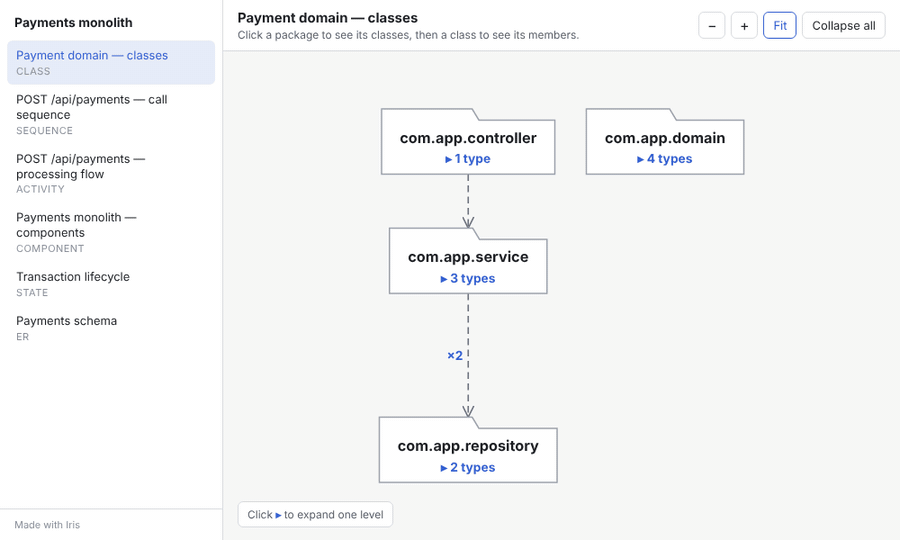
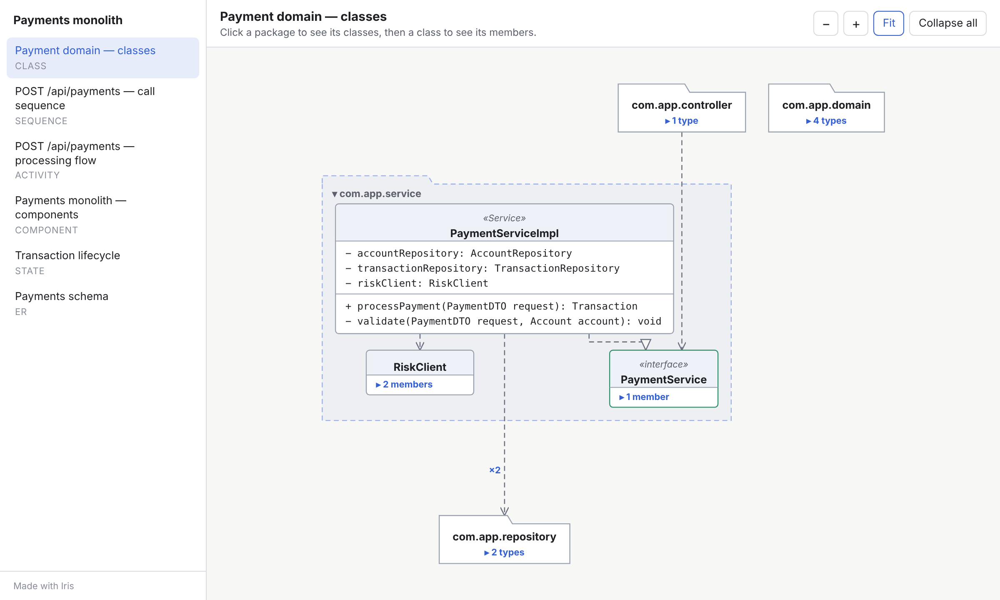
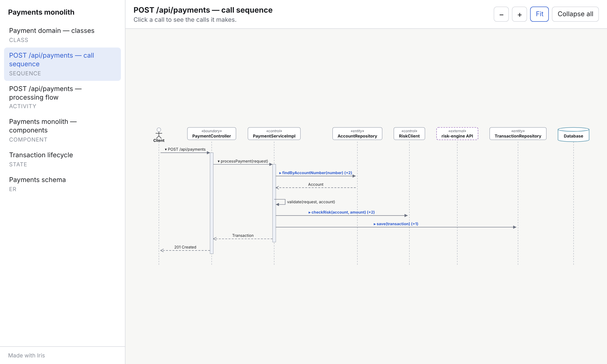
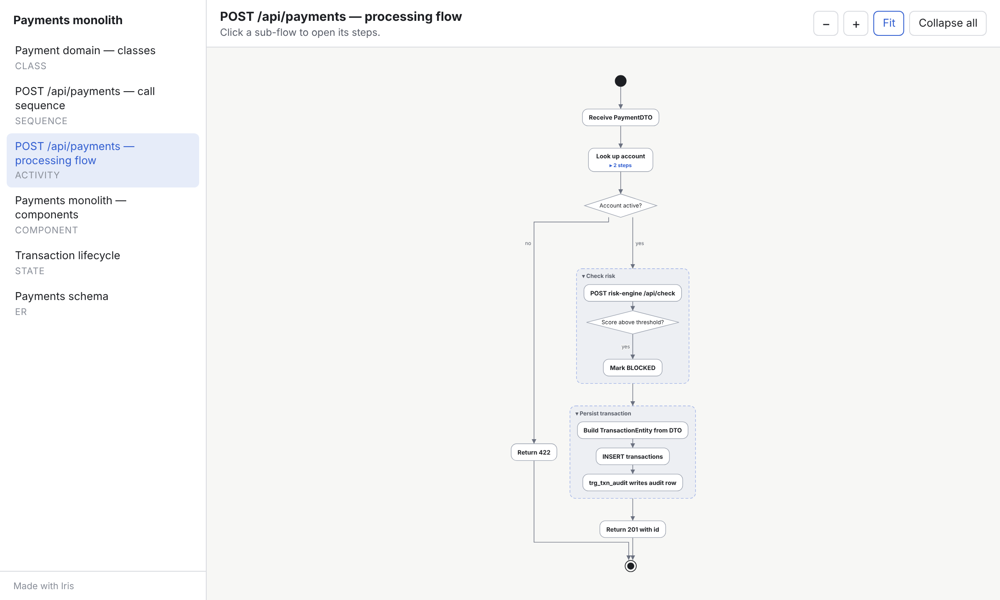
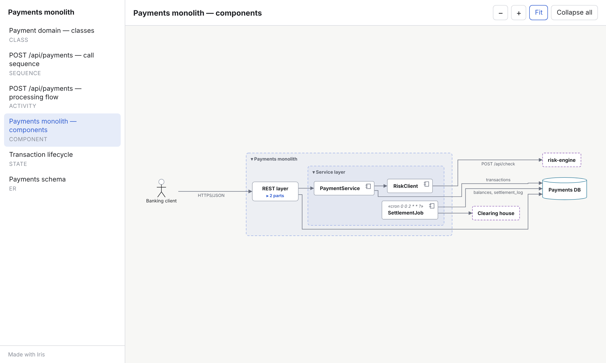
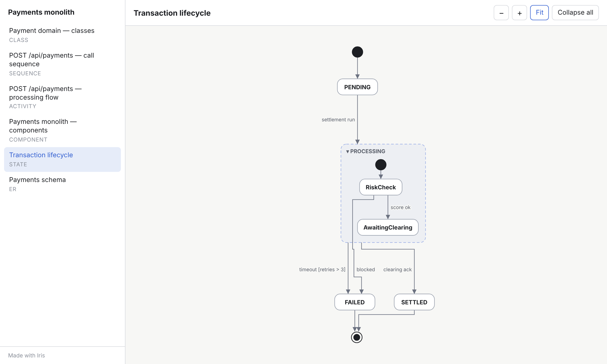
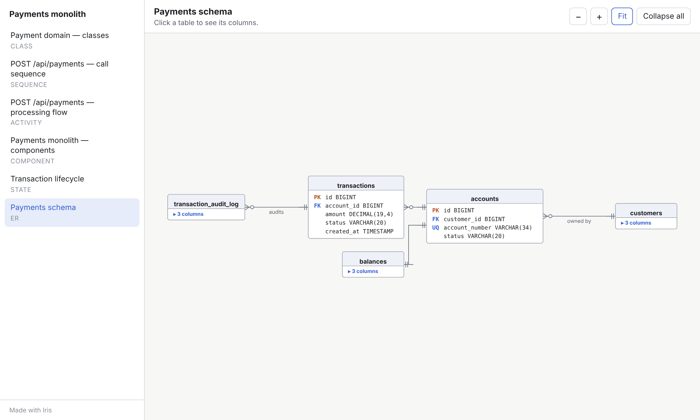
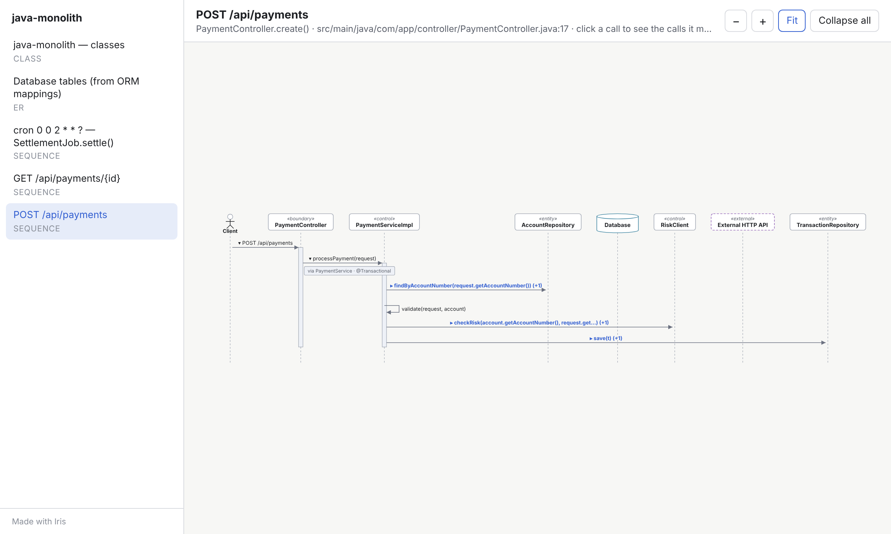
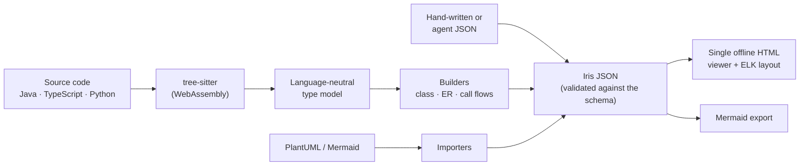

<div align="center">

# Iris

**Interactive UML and ER diagrams that open collapsed and expand one level per click.**

[](https://github.com/vthattey/iris/actions/workflows/ci.yml)
[](LICENSE)
[](package.json)
[](#diagram-types)



</div>

Large diagrams are hard to read when everything is drawn at once. Iris draws only the top level, and each
click opens one more level:

- a **package** opens to its classes, and a **class** to its fields and methods
- an **endpoint** opens to the calls it makes, and each **call** to the calls *it* makes
- a **table** opens to its columns
- a **system** opens to its containers, and a **container** to its components

Iris can read your code (Java, TypeScript, Python), import the PlantUML or Mermaid you already have, or render
JSON written by people or AI agents. The output is **one self-contained HTML file** that works offline in any
browser, so you can email it, commit it, or attach it to a ticket.

---

## Contents

- [Highlights](#highlights)
- [Diagram types](#diagram-types)
- [Install](#install)
- [Quick start](#quick-start)
- [Diagram a code base](#diagram-a-code-base)
- [Import PlantUML or Mermaid](#import-plantuml-or-mermaid)
- [Write diagrams as JSON](#write-diagrams-as-json)
- [Using the viewer](#using-the-viewer)
- [Command reference](#command-reference)
- [Use Iris from AI agents](#use-iris-from-ai-agents)
- [Library API](#library-api)
- [How it works](#how-it-works)
- [Performance](#performance)
- [Limitations and roadmap](#limitations-and-roadmap)
- [FAQ](#faq)
- [Contributing](#contributing) · [Security](#security) · [License](#license)

## Highlights

| | |
| --- | --- |
| **Progressive disclosure** | Everything starts collapsed. One click opens exactly one level, and the element you clicked stays put on screen. |
| **Six diagram types** | Class, sequence, activity/flow, component, state and ER, with proper UML and crow's-foot notation. |
| **Code to diagrams** | `iris analyze` builds a class diagram, an ER diagram from ORM mappings, and a call-flow sequence for every REST endpoint, scheduled job and message listener. |
| **Bring your own diagrams** | Import PlantUML and Mermaid; export any diagram back to Mermaid for Markdown, wikis and pull requests. |
| **Offline and private** | One HTML file with the layout engine inlined. No CDN, no server, no telemetry, so nothing about your code leaves your machine. |
| **Agent-ready** | Ships an [Agent Skill](skill/iris/SKILL.md) for GitHub Copilot, Claude Code and other agents, plus a JSON Schema that agents can write against. |
| **Scales** | Only open elements are laid out, so a 2,000-class diagram opens in under half a second. |
| **Accessible** | Keyboard navigation, screen-reader labels, light and dark themes that follow your system. |

## Diagram types

| | |
| :---: | :---: |
| **Class** · packages → types → members<br> | **Sequence** · calls nested under the call that makes them<br> |
| **Activity / flow** · sub-flows open to their steps<br> | **Component** · system → container → component<br> |
| **State** · composite states open to sub-states<br> | **ER** · tables open to their columns<br> |

All six come from [`examples/payments.iris.json`](examples/payments.iris.json).

## Install

Iris needs [Node.js](https://nodejs.org/) 18.17 or later.

**From GitHub, as a global command:**

```bash
npm install -g github:vthattey/iris
iris --version
```

**From a clone, for development or to use the Agent Skill:**

```bash
git clone https://github.com/vthattey/iris.git
cd iris
npm install
npm link          # optional: puts `iris` on your PATH; otherwise run `node bin/iris.js`
```

There is no native build step. The code parsers are WebAssembly, so installation works the same on macOS,
Linux and Windows.

## Quick start

```bash
# 1. Render the bundled example (all six diagram types)
iris render examples/payments.iris.json -o payments.html

# 2. Diagram your own code
iris analyze ./my-service -o my-service.iris.json --html

# 3. Make an existing PlantUML diagram interactive
iris import docs/architecture.puml -o architecture.iris.json
iris render architecture.iris.json
```

Open the `.html` file in any browser. Use the sidebar to switch diagrams, click ▸ to expand, drag to pan
and scroll to zoom.

## Diagram a code base

```bash
iris analyze <folder> [-o out.iris.json] [--html] [--lang java|ts|python]
```

One run produces one document with:

1. **A class diagram:** packages → types → fields, methods and enum constants, with inheritance,
   realization, injected dependencies and associations (`*` for collections). Getters and setters are hidden
   when a matching field exists.
2. **An ER diagram** (when ORM mappings exist): tables, columns, primary keys, foreign keys, uniqueness and
   nullability, with crow's-foot relationships.
3. **One call-flow sequence diagram per entry point:** the request comes in at the top, and each call opens to
   the calls it makes.

<p align="center"></p>

### What Iris recognises

| | Java (8–21) | TypeScript | Python |
| --- | --- | --- | --- |
| **Entry points** | Spring MVC (`@GetMapping`, `@PostMapping`, `@RequestMapping`…), JAX-RS (`@Path` + `@GET`…), `@Scheduled`, Quartz jobs, `@KafkaListener`, `@JmsListener`, `@RabbitListener`, `@SqsListener`, `@EventListener`, `main` | NestJS `@Controller` + `@Get`/`@Post`…, `@Cron`, `@Interval`, `@MessagePattern`, `@EventPattern` | FastAPI / Flask (`@app.get`, `@router.post`, `@app.route`…), Celery `@task` / `@shared_task` |
| **Dependency injection** | `@Autowired`/`@Inject`/`@Resource` fields, constructor injection, `final` bean fields | Constructor parameter properties (`private readonly x: X`) | `self.x: X = …` and `self.x = X()` in `__init__`, module-level instances |
| **Interface → implementation** | Resolved when exactly one implementation exists | Same, for interfaces and abstract classes | Same, for `ABC` and `Protocol` base classes |
| **ORM → ER** | JPA / Hibernate annotations, `@MappedSuperclass` inheritance | TypeORM decorators | SQLAlchemy (`Column`, `mapped_column`, `ForeignKey`), Django models |
| **Database calls** | Spring Data repositories (`save` → `INSERT/UPDATE`, `find…` → `SELECT`), `@Query`, `JdbcTemplate`, `EntityManager`, MyBatis `SqlSession` | TypeORM `Repository<T>`, `@InjectRepository` | `session`, `cursor`, `db` calls |
| **External calls** | `RestTemplate`, `WebClient`, `RestClient`, Apache/OkHttp clients, JAX-RS `Client` | `HttpService`, `axios`, `fetch` | `requests`, `httpx`, `aiohttp` |
| **Messaging** | `KafkaTemplate`, `JmsTemplate`, `RabbitTemplate`, `StreamBridge`, `ApplicationEventPublisher` | `ClientProxy`, `EventEmitter2` | — |
| **Notes on calls** | `via <Interface>`, `@Transactional` (with propagation) | `via <Interface>` | `via <ABC>` |

Tests are skipped by default (`--include-tests` keeps them). See [docs/code-analysis.md](docs/code-analysis.md) for
every rule, option and tip for large monoliths.

## Import PlantUML or Mermaid

```bash
iris import sequence.puml -o sequence.iris.json
iris import design.md -o design.iris.json       # every ```mermaid block in a Markdown file
```

| Format | Diagrams | How nesting is recovered |
| --- | --- | --- |
| **PlantUML** | class, sequence, activity (new syntax), state, component/deployment, IE entity (ER) | packages, `activate`/`deactivate`, `++`/`--`, `return`, `partition`, composite states |
| **Mermaid** | `classDiagram`, `sequenceDiagram`, `flowchart`/`graph`, `stateDiagram-v2`, `erDiagram` | namespaces, activations (`+`/`-`), subgraphs, composite states |

Details and the exact syntax supported: [docs/importing.md](docs/importing.md).

## Write diagrams as JSON

Any tool, script or AI agent can produce Iris JSON. A minimal ER diagram:

```json
{
  "iris": "1.0",
  "title": "Payments",
  "diagrams": [{
    "id": "schema",
    "type": "er",
    "title": "Payments schema",
    "elements": [
      { "id": "accounts", "kind": "table", "members": [
        { "name": "id", "kind": "column", "type": "BIGINT", "pk": true } ] },
      { "id": "transactions", "kind": "table", "members": [
        { "name": "id", "kind": "column", "type": "BIGINT", "pk": true },
        { "name": "account_id", "kind": "column", "type": "BIGINT", "fk": "accounts.id" } ] }
    ],
    "relations": [
      { "from": "transactions", "to": "accounts", "kind": "relationship", "fromCard": "*", "toCard": "1" }
    ]
  }]
}
```

The two rules that make diagrams progressive:

- **Graph diagrams** (class, component, activity, state, ER): set `"parent"` on an element to nest it. Children
  stay hidden until the parent is clicked. Relations to hidden children are drawn to the nearest visible parent
  and merged with a count (×3).
- **Sequence diagrams:** put the calls a message triggers in its `"children"`. They stay hidden until that
  message is clicked.

Full reference with every field and allowed value: [docs/json-format.md](docs/json-format.md).
Machine-readable schema: [`schema/iris-diagram.schema.json`](schema/iris-diagram.schema.json).

```bash
iris validate my-diagram.iris.json   # schema, unknown ids, wrong kinds, parent cycles
iris render   my-diagram.iris.json
```

## Using the viewer

| Action | Mouse / touch | Keyboard |
| --- | --- | --- |
| Expand or collapse one level | Click a node or call marked ▸ / ▾ | <kbd>Tab</kbd> to it, then <kbd>Enter</kbd> or <kbd>Space</kbd> |
| Pan | Drag the background | — |
| Zoom | Scroll wheel, or **−** / **+** | <kbd>-</kbd> / <kbd>+</kbd> |
| Fit to screen | **Fit** | <kbd>0</kbd> |
| Start over | **Collapse all** | — |
| Switch diagram | Sidebar | Browser back / forward |
| See source location and notes | Hover a node, member or call | — |

Each diagram has its own URL (`file.html#diagram-id`) you can share. The theme follows your system's light or
dark setting. More in [docs/viewer.md](docs/viewer.md).

## Command reference

| Command | Purpose |
| --- | --- |
| `iris render <doc.json> [-o out.html] [--diagram id]` | Render the interactive HTML (validates first) |
| `iris validate <doc.json> [--strict]` | Check a document; `--strict` fails on warnings too |
| `iris export <doc.json> [-o out.md \| --dir folder]` | Mermaid: one Markdown file, or one `.mmd` per diagram |
| `iris import <file> [-o out.json]` | `.puml`/`.plantuml`/`.pu`, `.mmd`/`.mermaid`, or `.md` with mermaid blocks |
| `iris analyze <folder> [-o out.json] [--html] [options]` | Code → class, ER and call-flow diagrams |
| `iris schema` | Print the path of the JSON Schema |

Use `-` as the input to read from stdin. Exit codes: `0` success, `1` invalid input, `2` usage error.
Every option is documented in [docs/cli.md](docs/cli.md).

## Use Iris from AI agents

Iris includes an [Agent Skill](skill/iris/SKILL.md): instructions that tell an agent when to use Iris, which
command fits which input, and how to design diagrams that read well one click at a time.

| Agent | Install the skill |
| --- | --- |
| **GitHub Copilot** | Copy `skill/iris` to `.github/skills/iris` in your repository, or `~/.copilot/skills/iris` for yourself |
| **Claude Code** | Copy `skill/iris` to `.claude/skills/iris`, or `~/.claude/skills/iris` |
| **Other agents with Agent Skills** | Copy `skill/iris` to the agent's skills folder (for example `.agents/skills/iris`) |

The skill calls the `iris` command, so install Iris on the same machine first.

**In multi-agent systems,** treat Iris as a rendering service with a simple contract: any agent that holds
knowledge (a code crawler, a database agent, an architecture planner) writes Iris JSON, then runs
`iris validate` and `iris render`. [docs/agents.md](docs/agents.md) shows how to map call chains, table
schemas and service maps onto Iris diagrams, and how to call Iris from CI.

## Library API

```js
import { writeFileSync } from 'node:fs';
import { validate, renderHtml, exportMermaid, mermaidMarkdown } from 'iris-diagrams';
import { analyze } from 'iris-diagrams/analyze';
import { importFile, importMermaid, importPlantUml } from 'iris-diagrams/import';

const { doc, warnings, stats } = await analyze('./src', { lang: 'java', maxDepth: 6 });
const check = validate(doc);            // { ok, errors: string[], warnings: string[] }
if (check.ok) writeFileSync('app.html', renderHtml(doc));
```

| Export | Signature |
| --- | --- |
| `validate(doc)` | → `{ ok, errors, warnings }` |
| `renderHtml(doc)` | → HTML string (self-contained) |
| `toMermaid(diagram)` / `exportMermaid(doc)` / `mermaidMarkdown(doc)` | → Mermaid text / `[{ id, title, type, mermaid }]` / Markdown |
| `analyze(folder, options)` | → `Promise<{ doc, warnings, stats }>` |
| `importFile(path, text)` / `importMermaid(text, name)` / `importPlantUml(text, name)` | → Iris document |

## How it works



- **Viewer** (`viewer/`): vanilla JavaScript and SVG with the [ELK](https://github.com/kieler/elkjs) layered layout
  engine inlined. Only expanded elements are laid out; hidden endpoints are re-routed to their nearest
  visible parent. Sequence diagrams use a dedicated lifeline renderer.
- **Analyzers** (`src/analyze/`): per-language extractors turn tree-sitter syntax trees into one model of types,
  fields, methods, annotations and calls. The class, ER and flow builders work only on that model, so adding a
  language means writing one extractor.
- **Importers and exporter** (`src/import/`, `src/export/`): line-oriented translators with no dependencies.

Contributor-level detail: [docs/architecture.md](docs/architecture.md).

## Performance

Measured in headless Chromium on a generated class diagram with 2,000 classes in 40 packages and 4,000 random
dependencies, which is far denser than real code:

| Action | Time |
| --- | --- |
| Open the file (40 collapsed packages) | ~0.4 s |
| Expand a package (+50 classes, re-layout of 90–290 nodes) | ~0.7–1.2 s |

Code analysis, measured with Node.js 22 on a 1,040-file Java project (1,200 types, 320 entry points):

| Action | Time |
| --- | --- |
| `iris analyze` (parse, build class + ER + 300 call flows) | ~0.5 s |

The generated HTML starts at about 1.7 MB, most of it the bundled layout engine, and grows with the number of
diagrams (2.9 MB for the 300 call flows above). It compresses to roughly a fifth of that.

## Limitations and roadmap

**Current limits**

- Code analysis is static. Reflection, bean names in strings, XML-only bean wiring, AOP proxies and dynamic
  dispatch across several implementations are not followed. An interface with several implementations is shown
  at the interface.
- Activity diagrams are not generated from code yet; import them or write them as JSON.
- One language per `analyze` run.

**Planned**

- [ ] Remaining UML types: use case, deployment, object, package, communication, timing, interaction overview
- [ ] Activity diagrams from method bodies (branches and loops)
- [ ] Spring XML bean definitions and MyBatis mapper XML
- [ ] Search and "trace a path" highlighting in the viewer
- [ ] Static SVG/PNG export of the current view
- [ ] Publish to the npm registry

Ideas and requests are welcome in [issues](https://github.com/vthattey/iris/issues).

## FAQ

<details>
<summary><b>Does Iris send my code anywhere?</b></summary>

No. Analysis runs locally, and the generated HTML contains everything it needs. It makes no network requests
when opened.
</details>

<details>
<summary><b>How is this different from PlantUML or Mermaid?</b></summary>

They draw everything at once, which works for small diagrams. Iris is for diagrams too big to read that way:
it shows the outline first and lets you open one level at a time. It also reads code directly, and it imports
and exports those formats, so you can keep using them.
</details>

<details>
<summary><b>Can I diagram a legacy Java 8 application?</b></summary>

Yes. The Java grammar covers Java 8 through 21, and the analyzer understands Spring MVC, JAX-RS, JPA/Hibernate,
Spring Data, `@Scheduled`, Quartz and JMS/Kafka listeners, which are the common building blocks of older
enterprise applications. See [docs/code-analysis.md](docs/code-analysis.md#large-and-legacy-code-bases) for tips.
</details>

<details>
<summary><b>The generated call flow is missing a call. Why?</b></summary>

Iris keeps calls to project types it can resolve statically: injected beans, repositories, the class itself,
and known HTTP/database/messaging clients. Calls on local DTOs or entities (getters, setters) are hidden on
purpose. Calls through reflection or an interface with several implementations can't be followed. Raise
`--max-depth` if the flow stops with "depth limit reached".
</details>

<details>
<summary><b>Can I edit the generated diagrams?</b></summary>

Yes. `iris analyze` writes plain JSON. Edit it (rename, regroup, add notes, delete noise), then run
`iris render` again.
</details>

<details>
<summary><b>Why is the HTML file 1.7 MB?</b></summary>

It embeds the ELK layout engine so it works offline. Gzipped it is about 480 KB.
</details>

## Contributing

Contributions are welcome: bug reports, new language extractors, importer coverage, viewer improvements and
documentation. Start with [CONTRIBUTING.md](CONTRIBUTING.md). Everyone taking part is expected to follow the
[Code of Conduct](CODE_OF_CONDUCT.md).

```bash
npm install
npm test               # unit, importer and analyzer tests; the browser test runs when Playwright is installed
npm run examples       # renders examples and fixtures into out/examples
```

## Security

Please report vulnerabilities privately, as described in [SECURITY.md](SECURITY.md).

## License

[MIT](LICENSE). The bundled ELK layout engine is licensed EPL-2.0.

## Acknowledgements

- The viewer's design began with the MIT-licensed **code-flow-graph** agent skill by biubiubiu533, which
  pioneered the "start fast, go deep on demand" diagram and connections that re-route to a collapsed parent. See [NOTICE](NOTICE).
- [ELK / elkjs](https://github.com/kieler/elkjs) for graph layout.
- [tree-sitter](https://tree-sitter.github.io/) and [tree-sitter-wasms](https://github.com/Gregoor/tree-sitter-wasms) for parsing.
