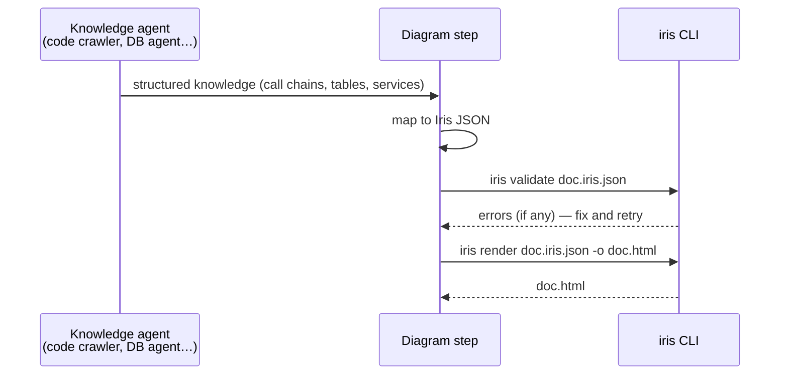

# Using Iris with AI agents

Iris is designed to be driven by agents as much as by people:

- an **Agent Skill** teaches an agent when to use Iris and how to design diagrams that read well one click at
  a time
- a **JSON Schema** gives agents a precise target to write against
- `iris validate` gives specific, line-item errors an agent can fix in a loop
- the output is a single file an agent can hand back to a person

## Install the skill

The skill lives in [`skill/iris/`](../skill/iris/): `SKILL.md` plus `references/schema-guide.md`.

| Agent | Repository-level | Personal |
| --- | --- | --- |
| GitHub Copilot | `.github/skills/iris/` | `~/.copilot/skills/iris/` |
| Claude Code | `.claude/skills/iris/` | `~/.claude/skills/iris/` |
| Other Agent Skills–compatible agents | `.agents/skills/iris/` (or the agent's documented folder) | — |

```bash
# from the root of the repository you want to diagram
mkdir -p .github/skills && cp -r /path/to/iris/skill/iris .github/skills/
```

Install the CLI on the same machine (`npm install -g github:vthattey/iris`), because the skill runs `iris`
commands. If the agent can't run commands, it can still write Iris JSON for you to render.

Example requests that trigger the skill:

- "Draw the class diagram for the billing module."
- "Show me how `POST /api/orders` flows through the code, as a diagram I can click through."
- "Turn `docs/architecture.puml` into an interactive diagram."
- "Make an ER diagram of the tables touched by the settlement job."

## The contract for agent systems

In a multi-agent system, treat Iris as a rendering service:



1. An agent that holds knowledge produces **Iris JSON**, following [json-format.md](json-format.md) or
   the shorter [schema guide](../skill/iris/references/schema-guide.md).
2. Run `iris validate`. Errors name the exact field and id, so an agent can correct them and retry.
3. Run `iris render` and return the HTML.

Alternatively, run `iris analyze` directly on the source tree and post-process the JSON (add notes, regroup,
remove noise) before rendering.

### Mapping common knowledge to diagrams

| Knowledge an agent has | Iris diagram | Shape it as |
| --- | --- | --- |
| Endpoint or job call chain (controller → service → repository → table, downstream APIs) | `sequence` | One top message for the entry point; each call nested under the call that makes it; database and external systems as `database` / `external` participants; transaction boundaries and side effects in `note` |
| Database catalog (tables, columns, PK/FK, unique, nullability, triggers) | `er` | Tables as elements, columns as members, FKs as `fk` plus a `relationship`; trigger and CHECK text in `note`; group by `schema` |
| Reverse lookups ("which code writes this table?") | `component` or `sequence` | The table as a `database` element with `writes`/`reads` relations from each writer |
| Classes, interfaces, packages | `class` | Packages as parents; inheritance, realization and dependency relations |
| Services, modules, bounded contexts, target architecture | `component` | `system` → `container` → `component`; shared databases and external systems as their own kinds |
| Entity lifecycle (status columns, state transitions) | `state` | States with `event [guard]` transition labels; composite states for sub-processes |
| Business process or decision logic | `activity` | Sub-processes as `subflow` with their steps as children |

### Example: call chain → sequence

Knowledge from a crawler:

```json
{ "entryPoint": "POST /api/payments",
  "callChain": [
    { "class": "PaymentController", "method": "create", "calls": ["PaymentService.processPayment"] },
    { "class": "PaymentServiceImpl", "method": "processPayment", "calls": ["AccountRepository.findByAccountNumber", "TransactionRepository.save"] } ],
  "tablesAccessed": [ { "table": "accounts", "operation": "READ" }, { "table": "transactions", "operation": "WRITE" } ] }
```

Iris JSON:

```json
{ "iris": "1.0", "diagrams": [ {
  "id": "post-payments", "type": "sequence", "title": "POST /api/payments",
  "participants": [
    { "id": "client", "kind": "actor" },
    { "id": "PaymentController", "kind": "boundary" },
    { "id": "PaymentServiceImpl", "kind": "control" },
    { "id": "AccountRepository", "kind": "entity" },
    { "id": "TransactionRepository", "kind": "entity" },
    { "id": "db", "label": "Database", "kind": "database" } ],
  "messages": [ { "from": "client", "to": "PaymentController", "label": "POST /api/payments", "children": [
    { "from": "PaymentController", "to": "PaymentServiceImpl", "label": "processPayment(request)", "children": [
      { "from": "PaymentServiceImpl", "to": "AccountRepository", "label": "findByAccountNumber(number)", "children": [
        { "from": "AccountRepository", "to": "db", "label": "SELECT FROM accounts" } ] },
      { "from": "PaymentServiceImpl", "to": "TransactionRepository", "label": "save(transaction)", "children": [
        { "from": "TransactionRepository", "to": "db", "label": "INSERT INTO transactions" } ] } ] } ] } ] } ] }
```

## In CI

Keep diagrams current by regenerating them on every merge:

```yaml
# .github/workflows/diagrams.yml
name: Diagrams
on:
  push:
    branches: [main]
jobs:
  diagrams:
    runs-on: ubuntu-latest
    steps:
      - uses: actions/checkout@v4
      - uses: actions/setup-node@v4
        with:
          node-version: 22
      - run: npm install -g github:vthattey/iris
      - run: iris analyze . -o docs/diagrams/app.iris.json --html
      - run: iris export docs/diagrams/app.iris.json -o docs/diagrams/app.mermaid.md
      - uses: actions/upload-artifact@v4
        with:
          name: diagrams
          path: docs/diagrams/
```

## Tips for agents writing JSON

- Validate early and often. `iris validate -` reads from stdin, so no temporary file is needed.
- Use stable, readable ids (`PaymentServiceImpl`, `accounts`), not counters, so diffs between runs stay small.
- Keep the first level to roughly 5–12 items, and nest the rest.
- Put the evidence in `source` (file and line) and `note` (annotations, constraints, side effects), so readers
  can check the diagram against the code.
