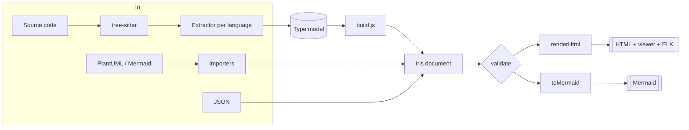

# Architecture

This page is for contributors. It explains how the pieces fit together and where to make common changes.

```
iris/
├── bin/iris.js                 CLI: argument parsing, reading/writing files, exit codes
├── src/
│   ├── index.js                Public API: validate, renderHtml, toMermaid, exportMermaid, mermaidMarkdown
│   ├── model/
│   │   ├── kinds.js            Allowed element/relation kinds per diagram type, container kinds
│   │   └── validate.js         JSON Schema (ajv) + semantic checks
│   ├── render/html.js          Inlines template, CSS, ELK, data and viewer into one HTML string
│   ├── export/mermaid.js       Iris → Mermaid, one function per diagram type
│   ├── import/
│   │   ├── index.js            Picks PlantUML / Mermaid / Markdown by extension and content
│   │   ├── util.js             GraphBuilder, member parsing, quoting helpers
│   │   ├── mermaid.js          Mermaid → Iris
│   │   └── plantuml.js         PlantUML → Iris
│   └── analyze/
│       ├── index.js            File discovery, language choice, parsing loop
│       ├── parser.js           tree-sitter (WebAssembly) loader, one parser per language
│       ├── common.js           Type-name helpers: baseType, typeArgs, collectionOf, unwrap
│       ├── java.js             Java syntax tree → type model
│       ├── typescript.js       TypeScript syntax tree → type model
│       ├── python.js           Python syntax tree → type model
│       └── build.js            Type model → class diagram, ER diagram, call flows
├── viewer/
│   ├── template.html           Page skeleton with placeholders
│   ├── viewer.css              Theme variables (light/dark) and SVG styles
│   └── viewer.js               Layout, rendering and interaction (runs in the browser)
├── schema/iris-diagram.schema.json
├── skill/iris/                 Agent Skill
├── examples/                   Example documents
├── test/                       node:test suites and fixtures
└── scripts/                    Example builds and documentation screenshots
```

## Data flow



Everything converges on the **Iris document** (the JSON format). That keeps each part independent: importers
and analyzers never know about rendering, and the viewer never knows where a document came from.

## The type model

Extractors return an array of types in one neutral shape, so the builders work for every language:

```js
{
  id: 'com.app.service.impl.PaymentServiceImpl', name: 'PaymentServiceImpl', simpleName: 'PaymentServiceImpl',
  pkg: 'com.app.service.impl', file: 'src/main/java/…/PaymentServiceImpl.java', line: 15, lang: 'java',
  kind: 'class',                                  // class | interface | abstract | enum | record | annotation | module
  annotations: [{ name: 'Service', args: {} }],
  extends: [], implements: ['PaymentService'],
  imports: { PaymentService: 'com.app.service.PaymentService' },
  fields: [{ name: 'accountRepository', type: 'AccountRepository', visibility: 'private', final: true, annotations: [] }],
  constants: [],
  methods: [{
    name: 'processPayment', kind: 'method', params: [{ name: 'request', type: 'PaymentDTO' }], type: 'Transaction',
    visibility: 'public', annotations: [{ name: 'Transactional', args: {} }], line: 31,
    calls: [{ name: 'findByAccountNumber', args: 'request.getAccountNumber()', line: 32,
              recv: { kind: 'field', name: 'accountRepository' } }],
  }],
}
```

`recv.kind` is `self`, `super`, `field`, `var` (with `type`), `static` (with `type`), `module` (Python/TS module
name), `function` (a top-level function) or `expr` (unresolvable). `kind: 'module'` types hold top-level
functions and instances; they appear in call flows but not in class diagrams.

### Adding a language

1. Add the grammar key in `src/analyze/parser.js` (grammars come from `tree-sitter-wasms`).
2. Write `src/analyze/<lang>.js` that returns the type model above.
3. Register the file extension and extractor in `src/analyze/index.js`.
4. Teach `entryOf` in `build.js` the language's entry-point annotations, and `isBean` its DI markers if any.
5. Add a fixture under `test/fixtures/` and assertions in `test/analyze.test.js`.

To see a syntax tree while writing an extractor, parse a file and print `tree.rootNode.toString()`, or walk
it printing `node.type` and `fieldNameForChild(i)`.

## Builders (`build.js`)

- **Resolution.** `resolve(name, fromType)` tries fully qualified ids, then the file's imports, then a unique
  simple name, then the same package. `concreteImpls` walks subtypes so interface calls can go to a single
  implementation.
- **Class diagram.** Packages become containers (grouped when there are more than 25), types become elements,
  fields drive association/dependency relations.
- **ER.** `buildEr` reads ORM annotations or Python field initialisers; `tableName` applies each framework's
  default naming.
- **Call flows.** `entryOf` decides what is an entry point. `expand` walks calls recursively with a depth limit
  and a cycle guard; `target` decides whether a call is kept and where it goes (a project type, or an external
  HTTP / database / broker participant).

## Viewer (`viewer/viewer.js`)

- **State** per diagram: the set of expanded ids, the pan/zoom transform, and whether it has been fitted once.
- **Graph diagrams:** `buildElk` creates an ELK graph containing only visible elements. An expanded container
  becomes an ELK compound node; a collapsed one becomes a leaf sized by `measure`. Each relation's endpoints are
  replaced by their `visibleRep` (nearest visible ancestor), and duplicates are merged with a count. ELK returns
  coordinates relative to each edge's `container`, which `renderGraph` converts to absolute positions.
- **Sequence diagrams:** `renderSequence` lays out lifelines left to right, widens columns so labels fit, and
  lists visible messages top to bottom (depth-first through expanded `children`). Activation bars span an open
  message's descendants.
- **Anchoring:** before re-rendering, the clicked element's position is remembered, and the view is shifted
  afterwards so it stays still on screen.
- **Text measuring** uses a canvas 2D context with the page's fonts, so boxes fit their labels.

The renderer inlines everything. Data is serialised with `<`, `>`, `&`, U+2028 and U+2029 escaped so a
document can never close the `<script>` element it lives in (covered by a test).

## Tests

| Suite | Covers |
| --- | --- |
| `test/core.test.js` | Schema and semantic validation, script-safe HTML, Mermaid export and round trip |
| `test/import.test.js` | Every PlantUML diagram type and Markdown-embedded Mermaid |
| `test/analyze.test.js` | Java (Spring, JPA, JAX-RS), TypeScript (NestJS, TypeORM), Python (FastAPI, SQLAlchemy, Django) fixtures |
| `test/viewer.test.js` | In Chromium: every diagram type opens collapsed, one click opens exactly one level, keyboard toggling, no page errors. Skipped when Playwright is unavailable. |

```bash
npm test
```

## Release checklist

1. Update `CHANGELOG.md` and the version in `package.json`.
2. `npm test`, with Playwright installed so the browser test runs.
3. `npm run examples` and check the rendered files.
4. If the viewer changed: `node scripts/capture-docs.cjs` to refresh README images.
5. Tag `vX.Y.Z` and create a GitHub release.
