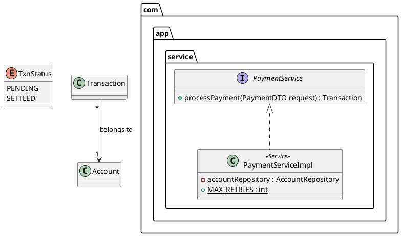

# Importing PlantUML and Mermaid

```bash
iris import <file> [-o out.iris.json]
iris render out.iris.json
```

Importers turn existing diagrams into Iris documents so they become interactive. Each import produces
one diagram (Markdown files produce one per `mermaid` block). The result is validated before it is written.

Hierarchy is recovered wherever the source has it, because that is what makes a diagram expandable: packages,
namespaces, subgraphs, partitions, composite states, and nested calls in sequence diagrams.

Unsupported lines are ignored rather than rejected, so a partially supported diagram still imports. Check the
result with `iris render` and tidy the JSON where needed.

## PlantUML

Files ending in `.puml`, `.plantuml`, `.pu` or `.iuml`, or any file containing `@startuml`. The diagram type is
detected from the content. Comments, `skinparam`, `title`, `legend`, `hide`/`show` and preprocessor lines are
skipped; `left to right direction` sets `direction: RIGHT`.

### Class



| Supported | Notes |
| --- | --- |
| `package` / `namespace` blocks (nested) | Become `package` parents |
| `class`, `abstract class`, `interface`, `enum`, `annotation`, `record`, `entity` | With `as` aliases, generics and `<<stereotype>>` |
| Members in `{ }` or `Class : member` lines | Visibility `+ - # ~`, `{static}`, `{abstract}`, `name : Type`, `Type name`, `method(args) : Ret` |
| Arrows `<\|--` `<\|..` `*--` `o--` `-->` `..>` `--` `..` (either direction) | Inheritance, realization, composition, aggregation, association, dependency; direction hints like `-up->` |
| Multiplicities and labels | `A "1" -- "*" B : label` |

### Sequence

| Supported | Notes |
| --- | --- |
| `participant`, `actor`, `boundary`, `control`, `entity`, `database`, `collections`, `queue` | With `"Label" as id` |
| `->`, `->>` (async), `-->` (reply), `<-` | Message kinds |
| `activate` / `deactivate`, `A -> B ++`, `--`, `return` | **Messages sent while a participant is active become children of the message that activated it**, which is how nesting is recovered |
| `note left/right/over` | Attached to the previous message |
| `alt`, `opt`, `loop`, `par`, `group`, `end`, dividers | Skipped (their messages are kept in order) |

### Activity (new syntax)

| Supported | Notes |
| --- | --- |
| `start`, `stop`, `end`, `kill`, `detach` | Start and end nodes |
| `:action;` | Action steps (also `|`, `<`, `>`, `]`, `/`, `}` terminators) |
| `if (...) then (...)` / `elseif` / `else` / `endif` | Decisions with labelled branches; branches re-join at the next step |
| `while (...)` / `endwhile`, `repeat` / `repeat while` | Loops |
| `fork` / `fork again` / `end fork` (and `split`) | Fork and join bars |
| `partition`, `group`, `package`, `rectangle`, `card` `{ }` | **Become sub-flows**: click to open their steps |
| `note left/right : …` | Notes |

### State

`[*] --> A`, `A --> B : event`, `state "Long name" as A`, `state A { … }` (composite, nested),
`state X <<choice>>`, and `A : description` (kept as a note).

### Component / deployment

`component`, `[Name]`, `database`, `queue`, `actor`, `node`, `cloud` (→ external), `rectangle`, `frame`,
`package`, `folder`, `artifact`, `interface`, with `as` aliases, `<<stereotypes>>` and nesting in `{ }`.
Arrows `-->` become `calls`, dotted `..>` become `uses`, with labels.

### IE / ER

```plantuml
entity accounts {
  * id : BIGINT <<PK>>
  --
  * customer_id : BIGINT <<FK>>
  status : VARCHAR(20)
}
accounts }o--|| customers : owned by
```

`entity`/`table` blocks; `*` marks NOT NULL; `<<PK>>`/`<<FK>>` tags; `||`, `|o`, `}o`, `}|`, `o{`, `|{` ends
become cardinalities.

## Mermaid

`.mmd`/`.mermaid` files, or Markdown (`.md`) files where every fenced `mermaid` block becomes a diagram.
`%%` comments and front matter are skipped.

| Mermaid | Iris | Notes |
| --- | --- | --- |
| `classDiagram` | class | `namespace` blocks → packages; `class X { }` members; `<<interface>>`, `<<enumeration>>`, `<<abstract>>`; generics `~T~`; all relation arrows with cardinalities and labels; `direction` |
| `sequenceDiagram` | sequence | `participant`/`actor` with `as`; `->>` `-->>` `-)` `--)` `->` `-->` `-x`; **`+`/`-` activations and `activate`/`deactivate` become nesting**; notes; control blocks skipped |
| `flowchart` / `graph` | activity | Node shapes (rounded, stadium, circle → action/start, double circle → end, rhombus → decision, subroutine → sub-flow, flag → note); `-->`, `-.->`, `==>`, `---` with `\|label\|` or `-- text -->`; `A & B --> C`; chains `A --> B --> C`; **`subgraph` → sub-flow**; `direction` |
| `stateDiagram` / `stateDiagram-v2` | state | `[*]` start/end (scoped to composite states), `state "Label" as X`, `state X { }`, `<<choice>>`, `X : label` |
| `erDiagram` | er | Entity blocks with `type name PK, FK, UK "comment"`; relationships with all crow's-foot ends and labels |

Mermaid flowcharts always import as **activity** diagrams, because Mermaid has no separate component type.
Change `"type"` to `"component"` and the element kinds if the flowchart is really an architecture diagram.

## Round trips

`iris export` followed by `iris import` preserves elements, members, relations and nesting for every diagram
type. This is covered by the test suite. Component diagrams come back as activity diagrams, for the reason above.
