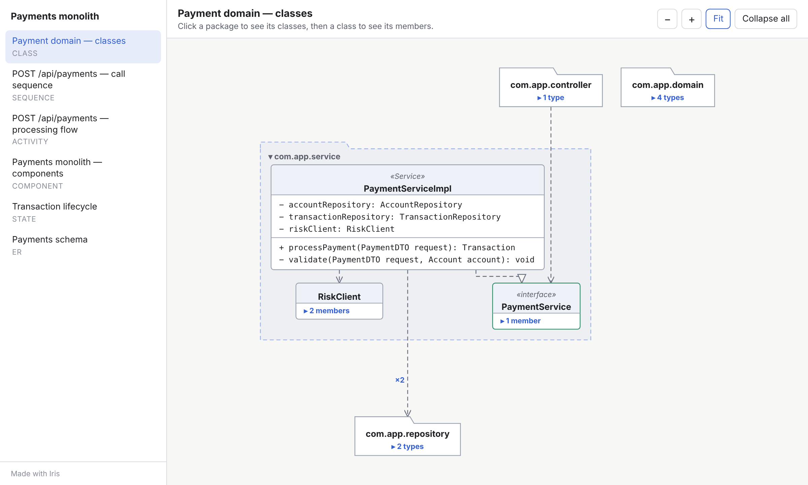

# The interactive viewer

Every `iris render` produces one HTML file containing the viewer, the layout engine and your diagrams.
It needs no server and makes no network requests: open it from disk, attach it to a ticket, commit it to a
repository, or host it on any static site.

## Layout of the page

- **Sidebar:** the document title and every diagram with its type. Hidden when the file has one diagram.
  On narrow screens it slides in from the ☰ button.
- **Header:** the diagram's title and description, and the zoom, **Fit** and **Collapse all** buttons.
- **Canvas:** the diagram. A hint in the corner disappears after your first click.

## Expanding and collapsing

Anything that can open shows **▸** with what is inside ("▸ 3 types", "▸ 5 members", "▸ 4 columns",
"(+2)" on a call). Click it to open **one level**; open elements show **▾** and close again on click.

| Diagram | Clicking… | …shows |
| --- | --- | --- |
| Class | a package | its classes (and sub-packages) |
| | a class, interface or enum | its fields, methods or constants |
| Sequence | a call | the calls it makes, with an activation bar on the receiver |
| Activity | a sub-flow | its steps, inside a rounded frame |
| Component | a system, container or node | its parts |
| State | a composite state | its sub-states and internal transitions |
| ER | a table | its columns with PK / FK / UQ badges |

Relations whose ends are hidden are drawn to the nearest visible parent and merged; a count such as **×3**
means three relations are rolled up into that line. Open the parent to see them individually.

After each click the element you clicked stays where it was on screen, so you don't lose your place as the
layout changes. **Collapse all** returns to the first view.

## Navigating

| Action | Mouse / touch | Keyboard |
| --- | --- | --- |
| Expand / collapse | Click | <kbd>Tab</kbd> to the element, <kbd>Enter</kbd> or <kbd>Space</kbd> |
| Pan | Drag anywhere | — |
| Zoom | Scroll wheel (zooms at the pointer), **−** / **+** | <kbd>-</kbd> / <kbd>+</kbd> |
| Fit to screen | **Fit** | <kbd>0</kbd> |
| Switch diagram | Sidebar | Browser back / forward |
| Details | Hover: source file and line, notes, annotations, FK targets, NOT NULL | — |

## Links

Each diagram has its own address, `payments.html#payment-sequence`. Links open straight to that diagram, and
the browser's back and forward buttons move between diagrams you have viewed.

## Themes

The viewer follows the operating system's light or dark setting. Colours are CSS variables at the top of
[`viewer/viewer.css`](../viewer/viewer.css). To force a theme, set `data-theme="light"` or `data-theme="dark"`
on the `<html>` element.

## Accessibility

- Expandable elements are focusable buttons with `aria-expanded` and a label such as
  "PaymentService, collapsed".
- After a click or key press, focus stays on the element you toggled.
- Colour is never the only signal: kinds are also distinguished by shape, stereotype text and line style.

## Embedding

The file is a normal web page, so you can:

- link to it, or host it with any static hosting (GitHub Pages, S3, an intranet share)
- put it in an `<iframe>`, pointing at `page.html#diagram-id` to open a particular diagram
- attach it to pull requests or wiki pages that accept HTML files

## Performance notes

Only open elements are laid out, using ELK's layered algorithm with orthogonal edge routing. A layout pass
runs after each click; a "Laying out…" badge appears if it takes longer than 150 ms. Diagrams with thousands of
elements stay responsive as long as the top level is grouped, which is the point of designing for
one-click-at-a-time (see [json-format.md](json-format.md#designing-for-one-click-at-a-time)).

## Test hooks

`window.__iris` exposes `toggle(id)`, `select(diagramId)` and `visibleIds()`. Iris's own browser tests use
them, and they are handy for automated screenshots.
